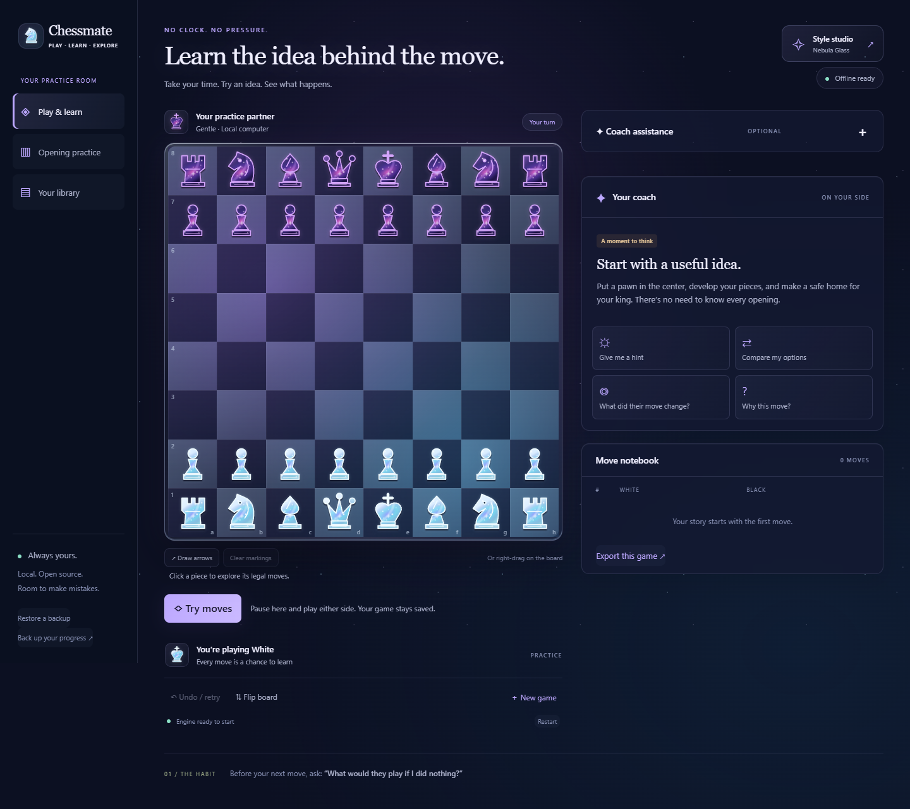

# Chessmate

Your free, local chess companion — a play on **checkmate**. Formerly LTW-Chess. The app, engine, lessons, and progress work without an internet connection after setup.

## New in 1.8 — a coach for every move in the line

**Your line coach** appears beside the board during exploration. With **Explain each move** enabled, it follows automatic playback, manual steps, and branch changes. For the selected move, it shows **What changed**, a **Possible purpose**, separate possible plans for White and Black, and the next reply in the saved line. Expand each side's saved continuation for more detail about its upcoming move. Terminal positions explain the result instead of inventing another plan.

Board facts come from the current legal position and full move history. Purposes and setup ideas are conditional advice; a saved continuation may come from the engine or your own exploration and is not described as a forced prediction. No chatbot or additional installation is required, and commentary makes no remote requests or extra engine searches.

Playback now starts at **Coach pace · 6s**. Choose another speed above the board or select **Pause to read**. Clicking **Show … on board** pauses playback and highlights relevant squares in either 2D or 3D. Navigation clears previous markings immediately. **Clear coach markings** removes the highlights. The independent **Explain each move** toggle is remembered and included in backups; older saves default to enabled. Your live game and pending move remain unchanged. Backup version and launchers stay the same.

## New in 1.7 — play out the possibilities

In exploration, choose **Play out 5 moves** or **Play out 10 moves** above the board. In the original-move comparison panel, the same buttons appear separately for **Original** and **Alternative**, even before requesting an explanation. Each choice builds up to 10 or 20 half-moves from the decision position (five or ten moves per side, including the starting move). Existing moves in the selected line are retained; the full-strength local engine extends short lines using complete position history. The line stops early for mate, stalemate, repetition, or another game-ending condition. These are possible continuations, not guaranteed predictions.

Playback starts when the continuation is ready. The controls above the board let you **Pause**, step **Previous / Next**, **Reset position**, **See final position**, and **Replay**. Choose quick, normal, or thoughtful playback speed. A short board-fact note follows the move and an arrow points to the next saved move during playback. Both 2D and 3D views work. You can pause and play your own move to create another branch.

Generation has visible progress and **Cancel line generation**. Navigating, switching branches, returning to the game, or restarting the engine cancels obsolete results. Completed lines and the current step survive reopening and JSON backup; reopening leaves playback paused. Your live game and pending original move stay untouched. **Play this alternative** still applies only the first move, never the imagined replies. No backup schema or launcher changes are required.

## New in 1.6 — a real table and remembered moves

Choose **3D · Table view** above the board for a locally rendered scene with sculpted pieces, board materials, lighting, and shadows. Drag to orbit, scroll or pinch to zoom, or use the camera buttons. With the canvas focused, arrow keys rotate, +/− zoom, and Home resets. **Flip board** also resets the camera for your color. Click a piece and then a destination to move; legal highlights and promotion work in both views. Choose **2D · Flat board** for keyboard square navigation or manual arrows. The view choice is included in backups and survives reopening. No remote models, textures, or fonts are needed. WebGL failure offers a flat-board fallback; actual M4/macOS graphics testing remains unverified.

After a pending move, choose **Try a different move** (or **Compare with…**). Your original is retained as a saved branch. Play an alternative, then select **Explain the difference** in the coach panel for two local searches with full position history. **Show both move arrows** returns to the decision position: gold is your original and aqua is the alternative. Click moves in either calculated line to inspect the position and a pink possible reply arrow. Scores are approximate; close searches are not called a clear improvement.

**Play this alternative** applies only the selected branch's first move through normal coaching. **Keep my original move** returns to the untouched pending game. Hypothetical replies never become actual game moves. Branches and the original reference survive reopening and JSON backup; comparison analysis can be requested again. Historical exploration cannot rewrite the game. Backup schema remains version 3, with optional fields compatible with existing saves.

## New in 1.5 — more room, more purposeful practice

The play area now uses the available desktop width. On wide screens, the board grows with the viewport and the coach and move notebook sit side by side. Lessons, review, and the learning library also expand while phone layouts remain stacked.

In **Opening practice → Practice with a purpose**, choose one of twelve openings for a focused session, or choose **Defend your king**, **Find a tactic**, **Finish the attack**, **Build a better position**, **Convert the endgame**, or **Defend against traps**. Sessions contain up to six positions from your chosen focus, with due reviews first and less-practiced positions next. Hints, retry, exploration, saved progress, and spaced repetition work just as in balanced sessions. A visible replacement warning appears if another session is paused; recorded results stay saved.

There are now **96 authored exercises across 21 modules**. Twelve new positions cover check responses, mate in one, and promotion decisions for both colors. The previous opening lessons and exercise IDs are preserved. Existing backups migrate as before; the optional session label is included in version 3 backups.

## New in 1.4 — a room of your own

Style studio now has eight boards and six piece sets, with a large live preview. New boards: **Ember**, **Deep Sea**, **Walnut**, and **Neon**. New pieces: **Porcelain** (distinct sculpted shapes), **Gilded**, and **Neon**. All artwork and materials are original SVG/CSS and work offline.

Changing boards now keeps your chosen pieces. Use **Use matching pieces** for the board's recommended pairing, or mix freely. **Reset appearance** restores Nebula/Galaxy, smooth moves on, and sounds off. Saved games and learning progress are unaffected. Existing appearance settings and backups remain supported; backup schema stays version 3.

## New in 1.3 — understand, practice, review

- **Coach assistance** now leads with What changed?, Check this threat, and Consider this plan. Click attacker, target, or defender labels to highlight the corresponding square; use Clear coach highlights to remove them. A legal recapture is not proof that a capture is safe.
- **Check this capture** lets you choose a legal capture and inspect a full-strength local engine reply without playing it. Explore this capture opens a separate branch. Suggested moves still require an explicit reveal unless you previously enabled them.
- **Opening practice → Start guided practice** builds a six-position session: two due reviews, two positions from your games, and two authored lessons, filling gaps with due items and new lessons. Authored topics rotate through openings, tactics, strategy, and endgames. Sessions, answers, hints, and exploration branches save automatically. Use Resume guided practice after reopening.
- Missed or answer-revealed guided positions return next session even if you solve them afterward. Successful positions use the existing 1, 3, 7, and 14-day spacing. Skipping alone does not change a schedule. The first two hints offer ideas; the third reveals the move.
- **Your library → Review** opens a separate game review; it never replaces your live game. Imported games ask which color to review. Analyze game calculates missing positions and saves each completed result. Cancel or leave and resume later. Up to three distinct moments are ranked by evaluation loss; retry before revealing the comparison, explore either line, or save the position for practice. Matching positions are saved only once. Recorded reviews use full history and approximately one second per search; scores are approximate, not human accuracy ratings.

Backups now use **version 3** and include guided sessions and review analysis. Versions 1 and 2 migrate automatically, retaining games, styles, practice, and exploration. Older application versions cannot restore version 3 backups. The browser address and internal database name are unchanged.

## Start on your Mac (including M4)

Use the same source repository: clone it or download and extract the source ZIP into a normal writable folder. The Windows portable package includes a Windows runtime; the Mac setup downloads its own runtime and rebuilds for your Mac.

1. Run **Setup Chessmate.command** once while online. It selects Apple Silicon (arm64) or Intel (x64), verifies the official Node 22.23.4 archive checksum, installs project dependencies, and builds Chessmate. It does not change system Node or require Homebrew.
2. Open **Launch Chessmate.command** to play at **http://127.0.0.1:4173/** in your default browser. Subsequent launches work offline.
3. Use **Stop Chessmate.command** to stop this copy's background server. Closing the browser does not stop it.

If a downloaded command is not executable, open Terminal, type `cd `, drag the extracted Chessmate folder into the window, and press Return. Then run:

```sh
bash scripts/setup-macos.sh
bash scripts/launch-macos.sh
# Later, to stop:
bash scripts/stop-macos.sh
```

Setup also sets executable permissions on the three `.command` launchers. macOS may ask you to approve downloaded software; review its normal security prompt for this project. These scripts do not remove quarantine flags or disable security settings. The `.cmd` launchers are for Windows; `.command` launchers are for macOS.

Mac scripts passed shell syntax and mocked architecture, checksum-failure, port, health, and process-ownership checks on Windows. **Execution on an actual M4 Mac has not yet been verified.** The browser app and single-threaded WASM engine are shared across platforms.

## Move progress from Windows to Mac

In Windows Chessmate, choose **Back up your progress**. Transfer that JSON file to your Mac, launch Chessmate there, and choose **Restore a backup**. Restoration replaces the destination browser's Chessmate data, including games, appearance, practice, saved branches, guided sessions, and reviews. If the Mac already has progress you want to retain, export its backup first. Keep using the same browser and `127.0.0.1:4173` address on each device. There is no automatic sync; PGN transfers games only.


## Start from GitHub (Windows)

1. Clone this repository, or use **Code → Download ZIP** and extract it.
2. Double-click **Setup Chessmate.cmd** once. It downloads a verified, project-local Node 22 runtime, installs dependencies, and builds the app. Internet is needed for this setup.
3. Double-click **Launch Chessmate.cmd**. Play at **http://127.0.0.1:4173/** in the same browser each time. No internet, login, subscription, or paid API is needed after setup.

The app includes click/drag chess, local Stockfish coaching, saved exploration branches, opponent-threat explanations, hints, opening recognition, 84 exercises, spaced practice, PGN import/export, and JSON backups. Choose glass boards and galaxy pieces in the Style studio.

## Chessmate 1.2.1

The app, launchers, and exported filenames now use **Chessmate**. Existing games, styles, lessons, explorations, and older backups continue to work: the browser address and internal `ltw-chess` database name intentionally stay the same. Original launcher filenames remain as compatibility aliases. The `CHESSMATE_PORT` and `CHESSMATE_TEST_URL` overrides accept the old `LTW_` names as fallbacks; the normal launcher always uses port 4173.

The Git repository contains source, local engine assets, lesson content, tests, and license notices. Generated builds, the downloaded Node runtime, dependencies, test/browser profiles, logs, and personal backups are excluded. The source archive for the bundled Stockfish engine is retained in `vendor/`.

## New in 1.2 — try an idea, understand the reply

**Try moves** opens a separate exploration board and pauses the real game. Move either color, use Previous / Next, click move chips, or Reset position. Step back and choose another move to keep a new alternative. Choose between alternatives in the dropdown; all are saved automatically in **Your library → Saved explorations** and JSON backups.

- **Computer reply once** makes one move at your selected opponent difficulty. You decide when to request another reply.
- **Compare alternatives from here** lets you select up to three legal moves, including your saved alternatives. Each receives a full-strength local search. Open a possible line to try its replies; scores are from White's perspective and are not guaranteed outcomes.
- **Return to game** restores your unchanged game, including a move awaiting your approval. **Use this move** is available only at your current decision: it applies the first move of your selected alternative through normal coaching. Historical exploration cannot rewrite the game.
- **Practice this position** saves an engine-backed candidate to your practice queue. The saved move is a candidate to study, not a claim that every other move is wrong.
- **Coach assistance** expands above the coach. Toggle opponent threats, opening ideas, position plans, and suggested moves independently. Ideas appear before answers by default. **Reveal suggested moves** enables calculated candidates and board arrows. Coaching follows the visible board and always uses full strength, independently of opponent difficulty.
- **Opening practice** now includes 12 opening modules and six foundation modules: 84 authored exercises in total. Filter by Openings or Chess foundations. The searchable offline explorer contains 3,865 named reference lines, with transposition recognition and no invented win-rate statistics.

Opening modules: Italian, Caro-Kann, Queen's Gambit Declined, Ruy Lopez, Scotch, Sicilian, French, Scandinavian, London, Queen's Gambit Accepted, Slav, and King's Indian. Foundations cover threats, forks/pins, safe captures, piece activity, pawn breaks/king safety, and basic endgames. The original 24 exercise IDs and practice history are preserved.

Version 1 backups migrate automatically to version 2 while retaining games, appearance, and practice records. Use a new version 2 backup with this release or later; older application versions cannot read its exploration records. Engine restart preserves the exploration board. Board moves remain available during analysis; moving or navigating cancels outdated results.

## New in 1.1 — your own chess atmosphere

Open **Style studio** at the top right to choose Nebula Glass, Aurora Glass, Obsidian, or the original Classic board. Choose Galaxy, Crystal, or Classic pieces independently. The new default is Nebula Glass with Galaxy pieces. Preferences save automatically; older saves and backups receive appearance defaults without changing games or practice records.

- **Draw arrows:** right-drag between two squares. Right-click a square to circle it. Draw the same marking again to remove it. On a touchscreen, enable **Draw arrows**, then drag or tap. Turn drawing off to move pieces. **Clear markings** removes drawings; changing position clears them automatically.
- **Visual hints:** hint two highlights a piece to investigate; hint three adds an arrow for the suggested move. Coaching facts with board locations have a **Show on board** button.
- **Explore at your pace:** use **Play line / Pause line** to watch a variation, or click its move chips to jump around. **Return to game** returns to your untouched game.
- **Smooth moves and sounds:** the style studio includes optional motion and move sounds. Sound is synthesized locally and is off by default. Your device's reduced-motion preference disables animations even if smooth moves is enabled.

All finishes, stars, gradients, pieces, and audio are generated by local SVG/CSS/Web Audio code; there are no image downloads or remote services.

## Start

On Windows, double-click **Launch Chessmate.cmd**. It opens http://127.0.0.1:4173 in your default browser. Use the same browser and address each time to keep your saved progress together. The Windows portable copy is already built and includes its own Node runtime. Your system Node is not changed. Mac users use the separate `.command` launchers above.

**Setup Chessmate.cmd** installs dependencies and rebuilds if you change the source or use a fresh source checkout; it needs internet. **Stop Chessmate.cmd** stops this app's background server. Closing a browser tab does not stop the server.

## Practice

- Play either color against Gentle, Steady, or Challenging. These are engine skill settings, not calibrated human ratings. Even Gentle can play strong moves.
- Move by clicking a piece and destination, or dragging. After your move, inspect the feedback and choose **Let the computer reply**, or **Undo / retry**.
- Ask for three levels of hints, compare up to three lines, or inspect what changed. Exploring does not change the actual game unless you explicitly choose **Use this move**. Click **Return to game** afterward.
- The engine's lines are possibilities, not predictions. Scores are approximate and depend on search depth. Board facts and general planning advice are labeled separately.
- The original three opening modules have eight exercises each; nine additional openings and six foundation modules have four each. Exercises ask for particular plans; a different legal move is not automatically bad.
- Missed exercises return in a new practice session. Successful exercises return after 1, 3, 7, and 14 days. Use **Start a new practice session** to begin a new session without closing the app.
- Finished games save up to three review positions. You can also save a feedback position yourself. Starting another game archives the current game in Your library.

## Save your work

Progress is stored in IndexedDB in your browser. Export a JSON backup from the sidebar or library periodically: clearing browser data deletes local progress. Restoring a validated backup replaces the app's current games, settings, practice records, and saved explorations. PGN imports add a single game to the library; exports use standard PGN. Exploration branches are retained in JSON backups, not game PGN exports. No data is sent off your PC.

## Develop and verify

On Windows, use `.runtime/node-v22.23.4-win-x64/node.exe` and put that directory first on PATH when running npm. On Mac, put `.runtime/node-v22.23.4-darwin-arm64/bin` (or `darwin-x64/bin`) first. Commands: `npm run dev`, `npm run build`, `npm test`, and `npm run test:browser` (Edge required). Run `python scripts/test-macos-launchers.py` for portable mocked launcher checks (Git Bash on Windows). The production launcher uses a small local-only static server rather than the development server.

Implementation: React + TypeScript, chess.js for rules and history, Stockfish.js 18.0.8 lite single-threaded WASM in a worker, IndexedDB for persistence. The coach uses explicit rules and authored lessons, not generated chat. Analysis is serialized; changing positions cancels queued work and destroys the old worker so stale results cannot update a different game.

Known boundaries: no online play, cloud sync, general conversational coach, calibrated human opponent model, or exhaustive opening book. Chess.js's automatic threefold/fifty-move draw behavior is used for this training app. The training engine does not use endgame tablebases. PGN import is one main-line game at a time; comments and side variations are not retained. Browser-local storage is not a substitute for an exported backup.

See `THIRD-PARTY-NOTICES.md`, `LICENSE`, and `TEST-RESULTS.md` for licenses and validation details.

## Preview


